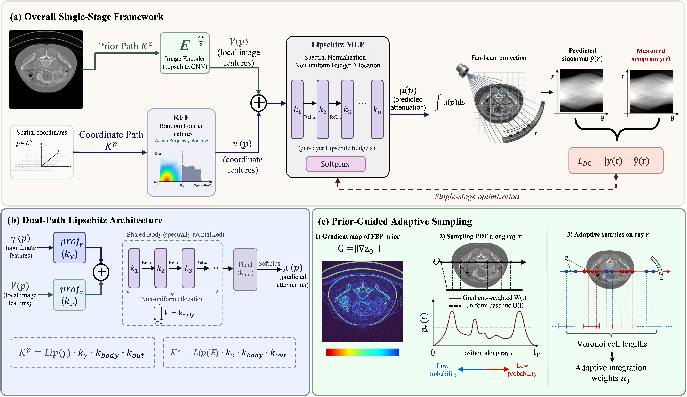
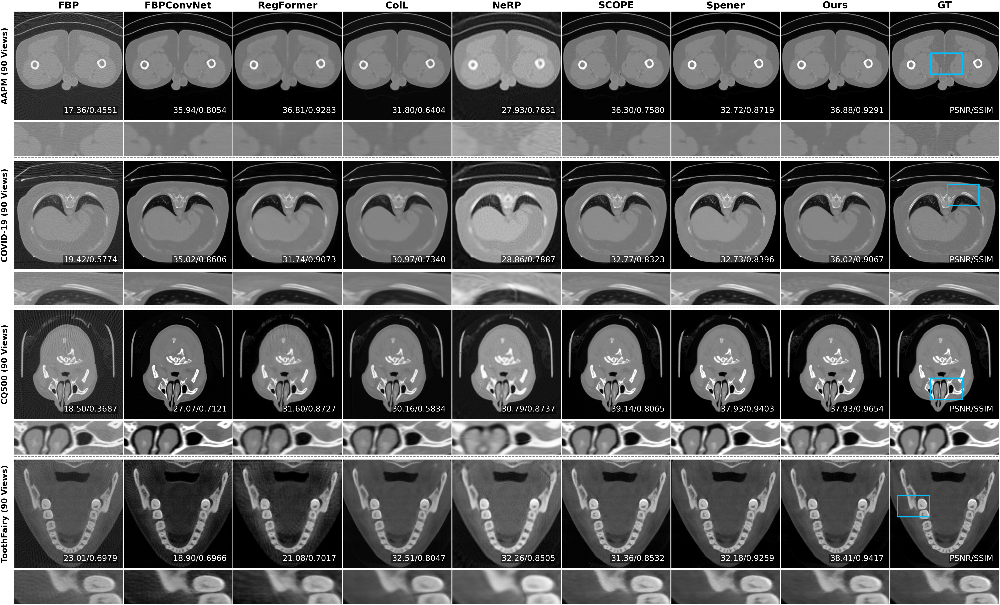

# FLIC: Taming Neural Fields with a Frequency-Lipschitz Curriculum for Sparse-View CT Reconstruction

**Official PyTorch implementation of our paper accepted at WACV 2027.**

**Taming Neural Fields with a Frequency-Lipschitz Curriculum for Sparse-View CT Reconstruction**

*IEEE/CVF Winter Conference on Applications of Computer Vision (WACV), 2027*

## Overview

FLIC is a frequency-Lipschitz curriculum framework for sparse-view computed tomography (CT) reconstruction based on implicit neural representations (INRs).

The framework combines frequency-aware representation learning with Lipschitz-constrained optimization, providing a structured curriculum for neural field reconstruction under sparse-view measurements.

## Framework

<p align="center">
  
</p>

## Reconstruction Results

<p align="center">
  
</p>

## Installation

We recommend Python 3.10 and a CUDA-compatible GPU environment.

Clone the repository:

```bash
git clone https://github.com/tao07211/FLIC.git
cd FLIC
```

Install dependencies:

```bash
pip install -r requirements.txt
```

PyTorch 2.4.1 is specified in the dependency list. Please ensure that your installed PyTorch build is compatible with your CUDA environment.

## Dataset Preparation

The implementation supports CT image inputs stored in NIfTI format (`.nii.gz`).

Organize your data as follows:

```text
FLIC/
├── assets/
├── config/
│   └── config.yaml
├── data/
│   ├── sample_001.nii.gz
│   └── sample_002.nii.gz
├── lipschitz/
├── FLIC.py
├── train.py
├── requirements.txt
└── README.md
```

The dataset is not included in this repository.

## Training and Reconstruction

Configure the input and output paths in `config/config.yaml`:

```yaml
file:
  input_path: data/
  result_path: output/
```

Run FLIC:

```bash
python train.py --config config/config.yaml
```

The training script supports processing individual NIfTI files or multiple `.nii.gz` files in a directory.

Reconstruction outputs and evaluation metrics are saved to the configured output directory.

## Configuration

The main experiment settings are defined in `config/config.yaml`, including:

- Sparse-view and dense-view projection parameters
- CT acquisition geometry
- Neural field architecture
- Random Fourier feature settings
- Lipschitz-related network parameters
- Frequency curriculum and scheduling parameters
- Training and optimization settings

Please adjust the configuration to match your dataset and experimental setup.

## Code Structure

| File / Directory | Description |
|---|---|
| `FLIC.py` | Main neural field architecture |
| `train.py` | Training and reconstruction pipeline |
| `dataset.py` | Dataset processing |
| `modules.py` | Neural network components |
| `sampling.py` | Sampling utilities |
| `schedule.py` | Curriculum scheduling |
| `lipschitz/` | Lipschitz-related operations |
| `config/` | Experiment configuration |
| `utils.py` | Supporting utilities |

## Citation

If you find FLIC useful in your research, please consider citing our paper:

**Taming Neural Fields with a Frequency-Lipschitz Curriculum for Sparse-View CT Reconstruction.** WACV 2027.

The official BibTeX citation will be added once the publication metadata is available.

## License

This project is distributed under the MIT License. See the [LICENSE](LICENSE) file for details. Any third-party code remains subject to its original licensing terms.
